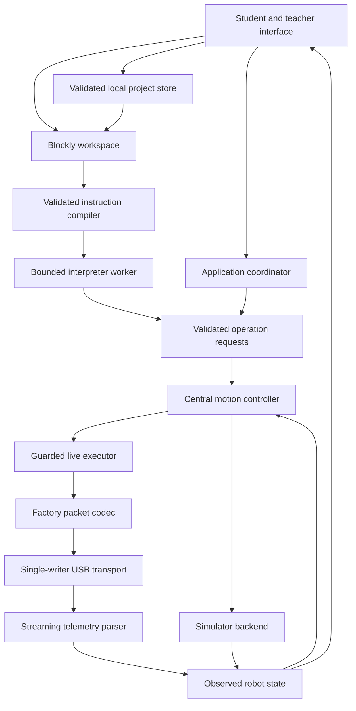

# NexArm Classroom architecture and implementation outline

Date: 2026-10-22  
Status: Proposed implementation design; no new hardware movement authorized  
Baseline: Working Connection Lab v0.6.1, commit `8d4f110`

This document turns [CODEX_HANDOFF.md](./CODEX_HANDOFF.md) and
[CODEX_PROMPT.md](./CODEX_PROMPT.md) into a buildable plan. Their safety and
privacy requirements remain mandatory. Module names, tooling, interfaces, and
the delivery sequence below are proposed design choices, not implemented features.
If a design choice conflicts with a mandatory requirement, the requirement wins.

## 1. What we are building

Students assemble blocks, predict their results, simulate, observe, and debug.
Later, a teacher-approved subset of those programs can control a commissioned
robot. The learning environment must remain useful when no robot is available
or school policy prevents USB access.

The first student release is simulation-only. It includes sequencing, events,
loops, conditionals, variables, simple functions, project saving, and accessible
feedback. It does not depend on completing XYZ movement or buying more equipment.

Priorities, in order:

1. Student physical safety and privacy.
2. Reliable operation, recovery, and classroom simplicity.
3. Teaching programming concepts.
4. Additional robot capabilities and visual polish.

No account, backend, remote control, student tracking, automatic movement,
automatic reconnection, firmware flashing, or arbitrary serial scripting is part
of this architecture. Hand-guided teaching remains excluded unless separately
researched and approved. Software Stop is not a certified emergency stop.

## 2. Baseline and migration strategy

The root `index.html` remains the known working, teacher-operated prototype.
It is not the student release and does not meet the proposed safety architecture.
Do not replace it while establishing the new application.

Build the new source under `app/`. Its development entry is `app/index.html`,
and its generated static output is `dist/`. The development build must not
overwrite root `index.html`, `CNAME`, or automatically deploy to production.
Use development branches and reviewable changes. Do not create a public copy of
the prototype and describe it as student-ready.

The existing application provides evidence for the connection settings and
packet behavior; it is not a source of verified mechanical limits. Carry over
its proven protocol through characterization tests, not by carrying over its
unrestricted UI-to-writer structure.

Baseline review findings to capture in regression tests:

- Fresh telemetry currently enables jog controls without separate arming.
- The relative +/-100 test window and generic raw range are not mechanical or
  collision limits. The 900 ms write interval is not a physical speed limit.
- The parser accepts an unexpected device ID as position telemetry and accepts
  an abbreviated checksum that does not cover payload bytes.
- There is no complete stop/fault state machine, motion completion supervision,
  or single queue covering diagnostic and movement writes.
- Connection attempts and cleanup use shared mutable port state; old callbacks
  must not be allowed to close a newer connection in the new implementation.
- Some labels understate confirmed telemetry or imply listening-only operation
  while motion buttons can be available.

Earlier isolated review probes decoded valid telemetry at all 29 two-chunk split
points and reproduced the device-ID and abbreviated-checksum gaps. Those probes
were not a committed test suite or a hardware safety certification.

## 3. Proposed technology choices

| Choice | Purpose and constraint |
| --- | --- |
| TypeScript, strict checking | Catch mismatched data and missing state handling before release. Runtime validation is still required. |
| Vite static build | Package browser assets for GitHub Pages, without an application server. |
| Blockly, bundled locally | Provide the visual editor. Use custom translation to structured instructions, not generated JavaScript execution. |
| Small DOM-based UI and CSS | Start without a general UI framework; keep dependencies and student-device work modest. |
| Dedicated interpreter worker | Keep student computation off the UI thread so Stop remains responsive. |
| IndexedDB with a storage adapter | Store structured projects and reviewed profiles locally; expose failures and a memory-only fallback. |
| Vitest and Playwright | Test pure logic, simulated hardware failures, browser flows, and network behavior. |

Exact dependency versions will be selected, license-reviewed, pinned, and locked
when scaffolding begins. Do not assume an unverified current version. Vendor or
bundle all required scripts, workers, fonts, icons, Blockly media, and language
files locally. Add no CDN or remote library fallback.

Do not add a service worker initially. The loaded simulator must need no runtime
data service, but that does not promise a first visit will work without internet
or that school browsers will retain cached assets. Installable/offline caching
can be a separate, tested improvement with an explicit update policy.

## 4. System boundaries and data flow



The diagram's simulator and live branches are exclusive. The composition root
constructs only simulator services in Learn mode; it must not instantiate a USB
transport, enumerate ports, or query/request serial permissions there. Load the
live adapter only after selection of Live Robot, without connection side effects.
Enable Connect once it is ready; call the browser's device picker directly from
that button's user gesture, before asynchronous work that could lose the gesture.
Lack of Web Serial must not break simulation.

All movement sources use the same motion controller: blocks, jog buttons, saved
poses, replay, future home actions, and future XYZ requests. The controller uses
an educational simulation profile in simulation and a separately commissioned
robot profile in live mode. A simulation profile never becomes a live profile.

Only the live executor owns the motion-writing capability. UI components,
Blockly extensions, project files, and the interpreter worker have no reference
to a serial writer. Protocol encoding is a pure function and grants no authority
to send its output. Enforce module dependencies with static checks and tests.

These boundaries prevent accidental or imported-program bypasses. Client-side
JavaScript, teacher menus, workers, and feature flags are not tamper-proof
security against someone controlling browser developer tools or a compromised
application dependency. Physical supervision and device-side safeguards remain
necessary.

## 5. Source layout and ownership

```text
index.html                         Existing v0.6.1; preserve during development
CNAME                              Existing production domain; preserve
app/
  index.html                       New development entry
  src/
    main.ts                        Composition root and startup
    application/
      AppController.ts             Modes, connection sessions, run ownership
      AppState.ts                  Read-only state snapshots and notifications
      Capabilities.ts              Release capabilities; live initially absent
    ui/
      shell/                       Workspace, controls, project menu
      status/                      Simulation/live, targets, faults, save status
      teacher/                     Commissioning and local diagnostics
      styles/                      Responsive layouts and focus styles
    blocks/
      definitions/                 Approved blocks and tooltips
      toolbox.ts                   Lesson-based block availability
      compileWorkspace.ts          Blockly data to validated instruction tree
    runtime/
      instructions.ts              Restricted language and value types
      Interpreter.ts               Explicit, bounded instruction execution
      interpreter.worker.ts        Worker entry; no hardware references
      WorkerProtocol.ts            Validated requests, replies, and budgets
    robot/
      RobotState.ts                Observed versus requested positions
      RobotProfile.ts              Versioned commissioned robot description
      Pose.ts                      Named measured or simulated joint vectors
    motion/
      MotionController.ts          Shared movement entry point
      SimulatorBackend.ts          Educational movement implementation
      GuardedLiveExecutor.ts       Only owner of live motion writes
    safety/
      SafetyState.ts               Arming, faults, session identity
      Preconditions.ts             Live readiness and per-command checks
      TrajectoryPlanner.ts         Bounded, approved movement segments
      FeedbackSupervisor.ts        Freshness, settling, deviation, stalls
      OperationQueue.ts            Cancellation and bounded single ownership
    protocol/
      NexArmCodec.ts               Pure factory encoder
      FrameParser.ts               Bounded streaming parser
      TelemetryDecoder.ts          Exact expected passive telemetry layout
    serial/
      WebSerialTransport.ts        Consent, stream lifecycle, serialized writes
      ConnectionLease.ts           Same-origin tab ownership and cleanup
    simulation/
      RobotSimulator.ts            Deterministic joint state, virtual clock
      JointPreview.ts              Honest schematic, not collision assurance
    projects/
      ProjectSchema.ts             File and stored record validation
      LocalProjectStore.ts         IndexedDB adapter and save status
      ImportExport.ts              Size limits, migration, download/upload UI
    lessons/                       Bundled sample projects and explanations
  public/                          Self-hosted media and other static assets
tests/
  unit/                            Codec, runtime, safety, storage validation
  integration/                     Fake transport, worker, lifecycle failures
  browser/                         Student flows, accessibility, network checks
  fixtures/                        Synthetic or teacher-approved sanitized bytes
docs/
  ARCHITECTURE.md                   This document
  CODEX_HANDOFF.md                  Mandatory requirements and known findings
  CODEX_PROMPT.md                   Engineering collaboration instructions
  ...                              Future operating and release documentation
```

Directories are a destination, not a requirement to create empty files upfront.
Add modules when their implementation has a clear caller and a meaningful test.

## 6. Core contracts

Use small, typed contracts plus runtime validation at every untrusted boundary.
The following is an interface sketch, not executable implementation:

```ts
type ServoId = 1 | 2 | 3 | 4 | 5 | 6;
type JointVector = readonly [number, number, number, number, number, number];

type MotionIntent =
  | { kind: 'jog'; servo: ServoId; deltaRaw: number }
  | { kind: 'moveToPose'; poseId: string }
  | { kind: 'setGripper'; setting: 'open' | 'closed' };

interface OperationContext {
  readonly sessionId: string;
  readonly runId: string;
  readonly operationId: string;
  readonly signal: AbortSignal;
}

interface MotionController {
  execute(intent: MotionIntent, context: OperationContext): Promise<MotionResult>;
  stop(reason: StopReason): void;
}
```

`MotionResult` distinguishes rejected, canceled, faulted, and settled outcomes.
A fulfilled serial write is never described as completed movement. Pose IDs are
resolved from a frozen, validated project snapshot for that run. Gripper settings
resolve through a commissioned profile, not a generic raw target. Numeric
validation includes finite values, bounds, conversion policy, and overflow checks
before encoding. Invalid requests are rejected, not silently clamped to a
different physical destination.

Robot state includes session ID, six observed raw positions, observation arrival
time, integrity classification, active target, motion phase, and fault reason.
Measured positions and target positions are separate fields. Use a monotonic
clock for freshness and deadlines. Browser arrival time is not proof of the
device's sampling time; buffered frames and post-connection settling need review.

Events and delayed replies carry session/run/operation IDs. After Stop, faults,
mode changes, or reconnects, responses from old identities cannot update active
state, restart a run, or send another command. Persisted files never supply active
session IDs, arming state, execution permissions, or queue contents.

## 7. Connection, motion, and program state

Track mode, connection, motion authorization, and program execution separately:

| Dimension | States |
| --- | --- |
| Mode | Learn/Simulate, Live Robot |
| Connection | Disconnected, Requesting permission, Opening, Listening, Closing, Fault |
| Motion authorization | Disarmed, Armed, Executing, Faulted |
| Program | Idle, Running, Paused in simulation, Completed, Stopped, Faulted |

Application startup always selects Learn/Simulate with no active connection or
live authorization. Switching to Live does not connect. Connecting does not arm.
Arming does not execute a program. Run cannot arm implicitly.

### Live arming conditions

All must hold, and must be checked again immediately before each write:

- The active session owns a supported factory-protocol connection and one writer.
- Continuous expected telemetry meets the reviewed integrity, timing, and
  plausibility policy; a single plausible frame does not establish readiness.
- An explicitly selected, commissioned profile matches the physical robot and
  setup. Current measured configuration is within the approved starting region.
- Joint limits, allowed movement types, physical stopping limitations, speed,
  gripper restrictions, workspace, and supervision requirements are satisfied.
- No fault, outstanding old write, concurrent run, pending configuration change,
  or backgrounded page exists.
- The operator explicitly confirms clearance and enables this session with
  teacher guidance. This confirmation does not replace machine-enforced checks.

Require a same-origin connection lease using a supported browser coordination
mechanism, plus actual successful exclusive port ownership. If exclusive
ownership cannot be established, live mode remains unavailable. Same-origin
coordination cannot control other websites or desktop serial applications.
Disable repeated connection attempts while permission/open/close is pending.
Cancellation and close are idempotent and scoped to their own session.

Stop, mode change, hidden page, USB/read/write failure, stale telemetry, unexpected
protocol behavior, unhandled application error, profile change, and detected
power interruption invalidate authorization and queued work. Do not claim all
power faults are detectable from this protocol. Treat navigation/close handling
as best effort; browser termination can prevent handlers from running.

Fault acknowledgment clears the displayed fault only after its cause is resolved;
it does not restore arming. Connection/protocol faults require explicit reconnect.
Other faults require revalidation and explicit rearming, never automatic resume.

### Stop, Pause, and Reset

| Control | Simulation | Live robot |
| --- | --- | --- |
| Run | Starts one validated program snapshot. | Requires explicit arming and a valid preflight; never changes pose first. |
| Pause | Freezes virtual execution/time and shows the current instruction. | Initially unavailable as a resumable pause. Use Stop until a hold/resume procedure is validated. |
| Stop | Cancels the run, event work, and pending simulated movement. | Immediately invalidates the run, disarms, and cancels future writes. No new stop/hold packet without separate approval. |
| Reset Simulation | Clears execution state and restores the simulated starting state. | Has no physical equivalent; no Reset/Home motion is implied. |

Stop cannot retract bytes already passed to the USB/device buffer. A software
write timeout does not establish that the device received nothing. On timeout,
mark that session unusable, cancel pending work, and close it without starting a
replacement writer. Keep the old operation quarantined until cleanup completes;
late promise completion cannot authorize more work. Require operator inspection
and explicit reconnect. Document that actual physical motion may continue and
require the commissioned physical cutoff procedure.

Do not implement torque-off or a speculative hold command as a Stop shortcut.
The initial architecture can cancel scheduling without claiming a physical stop.
Student live release requires an accepted, tested physical failure procedure.

## 8. Protocol and telemetry policy

Retain the established factory connection at 1,000,000 baud. No automatic baud
scan, firmware-mode switching, torque command, or bridge-mode fallback.

Factory goal-position encoder:

```text
FF FF [servo ID 1..6] 05 03 2A [position low] [position high] [checksum]
checksum = (~sum(bytes from servo ID through position high)) & FF
```

Passive position telemetry must match the complete expected structure:
`FF FF FF 1A 0B`, 24 payload bytes, and the applicable integrity policy.
Decode the last 12 payload bytes into six little-endian unsigned positions.
The 0..4095 check is a format/plausibility check, not a safe movement range.
Do not assign meaning to other fields without evidence.

The parser processes arbitrary chunks incrementally, caps memory/work, retains
partial headers, bounds frame sizes, and resynchronizes after malformed or
truncated input. Use bounded processing slices so noise cannot freeze Stop.
Unknown frames can appear in capped local diagnostics but do not refresh position
freshness. Test long noise runs, false headers, back-to-back frames, incomplete
frames, and corruption at every field, not only happy-path examples.

The abbreviated checksum compatibility case is a live-release blocker until
investigated. Label frames as full-checksum, abbreviated-only, or invalid.
Abbreviated-only frames may support clearly marked passive diagnostics, but must
not arm motion by default. Repeated plausible values or a teacher checkbox do not
restore payload integrity. If the factory stream only offers this weak integrity,
establish a verified alternative integrity/readback strategy with an explicit
safety review, or leave student live execution unavailable.

The experimental command-96 request stays outside the student application.
Any future diagnostic write must share the same connection writer and must not
interleave with a live run. Never expose a raw-byte text box in the student UI.

## 9. Movement planning, profiles, and commissioning

### Guarded execution

1. Resolve a validated intent against the frozen run/project and current profile.
2. Check session ownership, arming, telemetry, numeric inputs, and allowed action.
3. Validate the starting configuration and the proposed route, not just its end.
4. Plan bounded segments within approved position, velocity, acceleration,
   clearance, rate, and total-motion budgets.
5. Before each segment, recheck cancellation, freshness, profile revision, and
   expected state. Serialize actual writes through one owner.
6. Supervise fresh observed motion and require settling within a reviewed
   tolerance and deadline. Stop scheduling on excessive error or suspected stall.
7. Resolve completion only when feedback supports it. Never endlessly correct
   small errors; the handoff reports residual differences of about 5-9 raw units.

Start with one outstanding movement operation and tightly bounded buffering.
Do not prefill USB with a complete trajectory. New Run, jog, event, or replay
requests cannot overlap the active movement. No automatic retries of a write with
uncertain delivery. Feedback failure leads to a fault, not repeated commands.

Incremental targets alone do not prove physical velocity/acceleration limits.
Establish actual actuator behavior and limits through approved testing. Do not
assume undocumented speed registers or bridge commands work on factory firmware.
Live capability remains disabled if required movement constraints cannot be met.

Without verified geometry, the software cannot claim generic collision checking.
Early live capabilities must be restricted to individually reviewed movement
regions and actions with documented physical clearance. An approved sequence of
joint movements traces its actual sequential route; it is not a synchronized
straight-line tool movement. Multi-joint playback requires separate route
validation and teacher approval. Missing route evidence blocks that capability.

### Robot profile

A versioned local profile contains:

- Teacher-assigned robot label and physical identification procedure; USB vendor
  or product IDs alone do not uniquely identify an arm.
- Reviewed hardware/firmware context and commissioning evidence/revision.
- Servo mapping and directions, absolute approved limits, tighter working limits,
  allowed starting configurations, gripper restrictions, and payload assumptions.
- Verified motion bounds, timing, feedback tolerance, settle/stall deadlines,
  telemetry integrity/freshness policy, and approved movement capabilities/routes.
- Anchoring, clearance, cable routing, cutoff access, and supervision requirements.
- Geometry/tool frame only when measured and validated; unknown fields remain
  unknown and cannot silently receive permissive defaults.

No production numeric motion limits are invented here. Example freshness values
in the handoff are measurement targets, not authorization to ship those settings.
If required fields or evidence are absent, the profile cannot enable live motion.

Profile import is separate from project import and begins as untrusted draft data.
Review and physical robot association are explicit, locally recorded actions.
Approval metadata in a file is not proof of teacher approval. Modifying a profile
invalidates its approval and the active session. Profile selection never moves
the arm to match its neutral pose.

For an uncommissioned robot, default to passive inspection. A future teacher
commissioning workflow is a separate, specifically approved procedure for tiny,
single-axis tests in a reviewed local region. It cannot bypass every check under
a general "teacher mode" switch or silently explore for hard stops. It has no
student blocks, automatic sweeps, pose replay, or multi-axis execution.

### Pose recording

Record six fresh measured positions only after confirmed settling, with profile
revision, coordinate system, and source (`simulation` or `measured`). A simulator
pose is never described as measured. Reject stale recordings and unresolved pose
references. Renaming is harmless; editing joint values makes a pose unverified.
Imported poses and old-profile poses require validation before live use.

A saved pose is not an approved route. Names such as Home do not carry special
movement authority. Never infer object presence, gripping force, or secure grasp
from a gripper position reading. A feedback-based block can report a commissioned
position interval; it cannot promise that a held object is safe.

## 10. Blockly language and bounded execution

Blockly is the editor, not the runtime. Compile an allowlisted set of blocks to
a structured instruction tree, commonly called an AST. Reject unknown blocks,
invalid connections, unresolved names, incorrect value types, excessive nesting,
and unsupported capabilities before Run. Highlight the responsible block.

| Concept | First implementation | Later extension |
| --- | --- | --- |
| Events | One When Run clicked entry; bounded virtual button events | Arrived events after deterministic scheduling is verified |
| Sequence | Simulated joint/pose/gripper actions; capped wait; settled wait | Individually commissioned live equivalents |
| Loops | Repeat N, followed by bounded while | No unrestricted forever block |
| Conditionals | If/else, comparisons, boolean operators | Fresh-feedback predicates with explicit tolerances |
| Variables | Typed local number, boolean, and bounded text | Additional types only for a teaching need |
| Functions | Named functions, then typed parameters | No recursion initially, including indirect recursion |
| Debugging | Current block, variable values, plain-language errors | Simulation step-through and richer trace views |

Do not execute generated JavaScript, `eval`, `Function`, expressions from strings,
or imported executable plugins. Arithmetic is explicit and type-checked; reject
non-finite results and division errors. Treat saved block comments/names as text.

Use an explicit execution stack and a deterministic scheduler in the worker.
Limit instructions, loop iterations, function depth, event queue length, variable
and text sizes, simulated time, elapsed running time, and movement count. Freeze
project/pose contents at Run; edits apply to the next run. Require Stop before
switching a running workspace or project.

The main thread owns an independent elapsed-time watchdog and validates every
worker message. Only one movement request may be outstanding; the worker waits
for its result. Yield after bounded computation slices and check cancellation at
each instruction, wait, loop, function call, and movement boundary. Worker
termination must also cancel the main-thread motion operation; termination alone
is not a stop implementation or security sandbox.

Set initial simulation limits in code and tests rather than leaving them unlimited.
For example, choose an instruction ceiling below the handoff's 10,000-step stress
case and prove that that case stops. Tune UI responsiveness on a real Chromebook.
Simulation limits are educational controls, not physical safety settings.

Events share one run budget and one serialized scheduler. Reject repeated Run
while running. Bound queued virtual events and report overflow. Do not launch
parallel block stacks or allow arrival events to trigger uncontrolled motion
recursion. Pause/resume cannot reset lifetime run counters or revive canceled work.
Wall-clock budgets and the virtual simulation clock are separate; document how
intentional simulation pauses affect elapsed-time accounting.

## 11. Simulation and educational interface

Start with a schematic six-joint preview, actual simulated values, active targets,
and a current-block highlight. Use a deterministic virtual clock and repeatable
starting state so tests and lessons produce explainable results. Do not fake
physical XYZ or show a generic 3D arm as a validated model of this robot.

Run the same instruction semantics and intent validation in both modes. Substitute
the backend and profile, not a second loosely related language. The simulator
can exercise loss of feedback, stuck joints, and cancellation in developer tests.
Passing simulation does not certify a physical route or eliminate live preflight.

The student shell contains:

- A persistent Learn/Simulate or Live Robot label, with text as well as color.
- A lesson-focused toolbox, Blockly workspace, and status/preview region.
- Large Run and Stop controls, simulation Pause/Resume, and Reset Simulation.
- A project menu with New, local Save, Export, Import, and deletion controls.
- Visible save state: Saving, Saved on this browser, Not saved, or Memory only.
- Expandable variables and observations; raw serial diagnostics stay out of the
  student screen. Errors explain what happened and the next safe action.

Never rely on color alone. Provide visible keyboard focus, labeled controls,
screen-reader status updates without telemetry spam, reduced-motion support, and
a usable layout on the actual classroom Chromebook viewport. Blockly keyboard
operation and function/variable editing must be tested, not assumed accessible
because the surrounding buttons are accessible. Keep Stop reachable without
requiring the pointer or blocking browser dialogs. Avoid auto-repeat/held-key
jogging in the first live interface.

Bundle short challenges in progression: sequence and prediction; repeating a
pattern; conditionals; a variable-controlled repeat; decomposing a task into
functions; a virtual event. Each supplies a goal, starting project, observation
prompt, and debugging prompt. No student identity or grading service is required.

## 12. Local projects, import/export, and privacy

### Project format

Use a versioned JSON envelope containing format identifier, schema version,
application version, local project ID/title, Blockly workspace serialization,
named poses with provenance, and non-safety lesson/display settings. Reference a
robot profile by ID/revision where relevant, but never embed authoritative safety
limits or arming permissions. Generate executable instructions from validated
workspace data; do not trust a serialized compiled program from an import.

Parse files as data with limits on file size, nesting, block/pose count, text,
and number ranges. Validate before loading Blockly. Reject unknown executable
block types, forbidden keys, unsupported future schemas, and unresolved
references. Use allowlisted reconstruction rather than merging arbitrary objects
into application configuration. Never interpret imported content as HTML or code.
Offer an import preview and duplicate/copy policy instead of overwriting work
silently. Migrations operate on copies and never overwrite the only original
before a successful save. Importing a file cannot connect, arm, or move anything.

### Storage lifecycle

Save structured work to IndexedDB with explicit success/error states and atomic
record replacement. Debounce autosave after edits; bound retained history and
avoid storing raw serial streams. Keep a recovery copy where storage permits,
but do not promise it survives managed-device cleanup. If persistence is denied
or full, continue in memory and make Export prominent. A download being initiated
does not prove the file was retained by the school device.

Provide Delete Project and Clear Classroom Data with scope explained. Clearing
all app data first stops/disarms and closes live connections, then deletes
projects, poses, draft/reviewed profiles, settings, recovery copies, and local
diagnostics. No stale in-memory approval may survive deletion. Recommissioning or
explicit profile review is required afterward. Future caches must be added to
this deletion inventory if introduced.

Use teacher-approved neutral project/pose labels; do not prompt for names, email,
student IDs, school, or age. Free text can still contain personal information,
so explain that exported files should not contain student identifiers. Browser
storage is shared within the relevant browser profile and visible to device
administrators; it is not an encrypted student vault.

### Network and dependency policy

Allow static application asset loading from the site's own origin. No project,
position, serial, diagnostic, or run-history upload; no analytics, ads, remote
fonts, tracking pixels, external error reporters, cloud inference, WebSockets,
beacons, or network broadcasts. Ordinary hosting requests can expose IP addresses
and request metadata to hosting infrastructure; do not promise zero network
metadata or control over the host's logs.

Validate the built application with browser network recording and dependency
review. Test all flows, including help, error handling, imports, and worker
startup, for unexpected requests. Fail tests on unexpected destinations or data
requests, not just well-known analytics hostnames. Diagnostics are memory-only
and capped by default; export requires an explicit teacher action and local
sanitization review.

Design and test a Content Security Policy with bundled scripts, no dynamic code
execution, no runtime data connections, and restrictive object/base/form rules.
Account for Blockly styles/media, worker loading, and local download requirements.
Use the strongest policy supported by the actual hosting configuration; do not
claim a meta-tag policy supplies header-only protections. Check external links
and navigation separately because connection restrictions are not a complete
data-exfiltration defense. Review network behavior together with code and package
changes. Pin dependencies, commit a lockfile, record licenses, and prohibit
unreviewed runtime plugins. CSP reduces risk but does not make a compromised
same-origin bundle trustworthy.

## 13. Verification and release evidence

| Area | Required evidence before the corresponding release |
| --- | --- |
| Codec | Golden factory frames, endian cases, input rejection, full/abbreviated integrity classification, and exact telemetry ID/type/length checks. |
| Streaming parser | Fragmentation, corruption, noise, oversized chunks, memory bounds, recovery from false/truncated headers, and no UI starvation. |
| Transport | Permission denial, overlapping connect attempts, stream errors, disconnect during read/write, hanging writes, idempotent close, and stale-session cleanup. |
| Safety | No unarmed writes; missing limits reject; one writer; Stop cancels pending work; stale feedback and backgrounding disarm; late completions cannot restart execution. |
| Runtime | Every language concept, direct/indirect recursion rejection, adversarial nesting, non-finite arithmetic, event storms, bounded 10,000-step stress case, and prompt cancellation. |
| Storage | Round-trip export/import, malformed and oversized files, future schemas, quota/permission failure, injection attempts, deletion, and profiles separated from project authority. |
| Browser/UI | Simulation works with Web Serial absent; keyboard operation; Stop while running; no duplicate runs; clear mode/fault/save labels; actual Chromebook performance. |
| Privacy | Built-asset and network inspection, no data egress, local-only worker/media loading, storage inventory, and teacher-readable privacy documentation. |
| Hardware | Teacher-approved commissioning evidence, physical cutoff procedure, feedback/timing measurements, allowed routes, payload/gripper constraints, and fault tests within an approved physical procedure. |

Use fake transport and a controllable clock for automated safety tests. Include
fault injection at every await boundary around writes and disconnects. Physical
USB tests are manual and supervised, never run in CI. A passing software test
suite establishes software behavior under tested conditions, not mechanical
certification or proof of physical stop.

CI eventually runs locked dependency installation, static/type checks, unit and
integration tests, production build, and selected browser tests. Review dependency
and license findings. CI never opens a robot connection or deploys motion changes
automatically. Capture failures as local/CI test evidence without classroom data.

Student compatibility checks start early using a genuine district student account.
Confirm USB entitlement separately from simulation usability and verify local
save/export/download behavior. A supervised live pilot occurs only after hardware
commissioning and explicit teacher acceptance.

## 14. Delivery sequence and small work packages

The handoff's phase numbers remain useful requirement references. The sequence
below moves simulation-based education ahead of broad live movement so learning
can begin without resolving every mechanical question.

| Package | Concrete deliverable | Completion gate |
| --- | --- | --- |
| A: Preserve and characterize (Phase 0) | New-app build/test skeleton alongside the untouched baseline; codec/parser and baseline regression fixtures; compatibility and evidence notes. | Production unchanged; tests distinguish observed behavior from desired stricter behavior. |
| B: Simulator and safety model (Phase 1) | Application states, deterministic simulator, guarded operation interface, cancellation, fake-transport failure tests, visible status. | Simulation never touches USB; old session work cannot resume; missing live evidence always rejects. |
| C: First Blockly lesson (early Phase 3) | When Run clicked, sequence, joint simulation, wait, repeat, current-block highlight, Stop. | A student can build and debug a short program; huge loops remain interruptible. |
| D: Classroom simulation release (rest of Phase 3) | If/else, variables, functions, bounded virtual events, project persistence/import/export/deletion, lessons, accessible controls. | Real Chromebook/student-account checks and privacy review; useful with no robot. |
| E: Passive live connection | Explicit consent connection and telemetry status using extracted protocol; teacher diagnostics only; no motion-writing capability wired into this release. | Robust lifecycle and integrity evidence; no connect/load/reconnect movement. |
| F: Commissioned jog and pose recording (Phase 2 subset) | Separately approved single-axis commissioning/jog workflow, measured pose recording, calibrated feedback supervision. | Written command/test approval and reviewed robot profile; no student live release by default. |
| G: Approved replay and block motion (rest of Phase 2) | Validated routes, bounded pose transitions, eligible live blocks, preflight and fault recovery. | Each new movement behavior approved; physical failure procedure and supervised student pilot accepted. |
| H: XYZ research (Phase 4) | Measured geometry, FK/IK tests, orientation policy, route/collision validation, simulation first. | Separate live approval; leave unavailable if requirements cannot be demonstrated. |
| I: Optional hand-guiding (Phase 5) | Manufacturer-supported torque/gravity procedure, if feasible. | Separate physical-risk review and approval; otherwise excluded. |

Early student-account checks and final pilot evidence correspond to handoff
Phase 6; do not postpone every policy check until the end.

### First implementation changes, in order

1. Add the `app/` entry, strict TypeScript/build/test configuration, and a minimal
   simulation-only shell. Document how to run it without changing root production.
2. Add the pure factory encoder and streaming parser, using synthetic fixtures
   and captured sanitized samples when available. Test known quirks explicitly.
   Never make the baseline's weak checks an expected live-safety policy.
3. Add the application/session state model, fake transport, guarded motion
   contract, and Stop/fault tests before wiring any live writer.
4. Add deterministic simulated movement, visible state, and reset behavior.
5. Add the interpreter worker, a small approved block set, cancellation, and the
   first repeat-loop lesson. Then add storage and the remaining language concepts
   in separate, reviewable changes.

Each change reports what works, how it was verified, what remains unavailable,
and how the teacher can review it. A new live writer is not part of these first
changes. The build should prove simulation/education progress before hardware
investment becomes a prerequisite.

## 15. Approval and production release process

A request to build this architecture authorizes planning and non-motion software
work; it does not authorize new physical behavior. Before implementing a new live
movement behavior, present a concrete, reviewable proposal containing:

1. The exact factory command/register and example bytes where applicable.
2. Which joint(s) move, start conditions, movement region, and reviewed bounds.
3. Expected feedback, completion tolerance, deadlines, and stopping limitations.
4. Failure cases, cutoff access, supervision, and the proposed physical test.
5. Software/fake-transport results already available and rollback instructions.

Obtain teacher approval before introducing that behavior into the live path,
then approval for the supervised physical test before executing it. Approval for
jogging does not automatically cover pose replay, gripper behavior, home, XYZ,
torque changes, or hand-guiding. Routine simulation and read-only work continues
without repeated permission requests.

Keep development output separate from production. When a release is ready,
produce a static artifact, change list, validation results, privacy/dependency
inventory, operating instructions, and rollback artifact. Preserve `CNAME` and
the production domain when preparing deployment. Do not overwrite production
until teacher review; deployment instructions alone do not constitute approval
for new motion. Do not create tags, push branches, or publish from this outline.

Before a student live release, provide:

- Teacher commissioning and physical-cutoff checklist.
- Student operating instructions and training activity.
- Student privacy statement, storage/deletion explanation, and network inventory.
- Tested device/account compatibility matrix and known limitations.
- Release notes, accepted capabilities, evidence, and rollback instructions.

## 16. Open decisions and evidence needed

| Question | Current status | Effect on progress |
| --- | --- | --- |
| Which integrity form does factory passive telemetry actually provide? | Not established by saved fixtures in this repository. | Does not block simulation; blocks trusting that telemetry for live arming. |
| What are safe limits, directions, starts, paths, gripper/payload bounds, and physical speed behavior? | Teacher tests establish small moves, not complete commissioning. | Blocks affected live capabilities; never fill gaps with generic ranges. |
| What stops or holds the physical arm during failure? | Not verified; browser cancellation cannot guarantee it. | Blocks student live release until a tested procedure/safeguard is accepted. |
| How are robot and profile reliably associated after reconnect or mechanical changes? | Teacher identification/review workflow required. | Blocks automatic profile reuse and arming. |
| Can genuine district student accounts use USB and keep/download projects? | Teacher accounts tested; student accounts not yet verified. | Simulation can proceed; test policy and storage early. |
| Are geometry and tool frame accurate enough for XYZ? | Unverified. | XYZ remains research; no impact on first educational release. |
| Is hand-guiding manufacturer-supported without resisting joints or gravity drops? | Unverified. | Excluded from current implementation scope. |

There is enough information to start packages A-D without additional hardware
measurements. Ask for physical evidence only when the dependent work is ready,
with a specific supervised procedure. The teacher retains control over classroom
scope, equipment investment, and approval of each physical capability.
