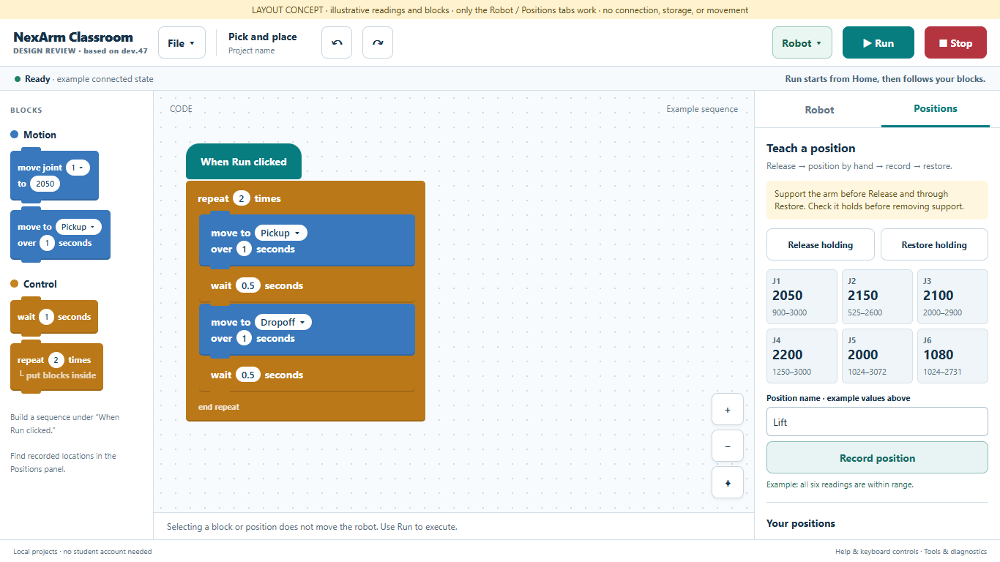

# Classroom workspace usability review

Reviewed 2026-10-27 against development version **0.7.0-dev.47**.

**Implementation update:** dev.48 implements the first workspace pass, including
persistent execution controls, the Robot/Positions inspector, co-located teaching,
File/Help menus, block groups, visible Undo/Redo and Add to code. The measurements
below describe the original dev.47 page. Project naming, autosave, destructive-edit
recovery and the broader accessibility/student studies remain future work.

## Recommendation

Organize NexArm Classroom around a screen-filling programming workspace. Keep
project controls and Run/Stop in a persistent toolbar, put the block palette on
the left, and group robot controls and named positions in a right-hand panel.
Use the physical robot in place of the on-screen stage shown in Scratch and
Tynker. Do not restore the simulator or XYZ tools.

[Open the layout concept](design/workspace-concept.html). This is an isolated,
illustrative mockup, not a replacement application. Its tabs work; its robot,
project, and block controls do not. It connects to nothing and stores nothing.

The current app already supports valuable classroom work: teaching measured
positions, sequencing movements, waiting, repeating, and saving a local program.
Those capabilities deserve a simpler route through the page. Improve their
presentation before adding more programming features.

## Scope and evidence

This is a source review and a heuristic browser review, using the three supplied
screenshots as design references. Chrome layout checks used simulated USB and
example positions; no physical robot was connected. This is not a student study,
proof of hardware safety, or a complete accessibility audit.

The checks used the default station page with the readings panel closed. At
1366 × 768, the Blockly editor begins **1,111 pixels from the top of the page**.
There are **13 buttons and five status regions before the editor**. When the
editor is scrolled into view, Stop is outside the viewport. With the recording
box in view, Release and Restore are outside the viewport.

| Browser viewport | Editor begins at | Stop visible while editing? |
| --- | ---: | --- |
| 1366 × 768 | 1,111 px | No |
| 1280 × 720 | 1,111 px | No |
| 1024 × 768 | 1,111 px | No |
| 390 × 844 | 1,823 px | No |

These are layout measurements for this build and test state, not measurements of
students' task times. The reproducible audit and screenshots are in the ignored
local `.analysis/usability/` directory. The page heights at the three larger
sizes were approximately 2,010–2,050 pixels before expanding teaching controls.

## What to learn from the supplied examples

| Shared pattern | Application to NexArm |
| --- | --- |
| A large, immediately visible coding area | Put Blockly on the first screen and let it use the available height. |
| Stable project and execution controls | Keep project name, File, Connect, Run, and Stop in predictable locations. |
| Blocks grouped by purpose | Start with Motion and Control. Four block types do not need a large category system. |
| A distinct area for the thing being programmed | Use a Robot / Positions panel, with readings and teaching controls, instead of a virtual stage. |
| A clear starting block | Begin new projects with one “When Run clicked” block. Put examples in a menu. |
| Consistent visual hierarchy | Give coding, running, and recording prominence; place diagnostics and development explanations behind Help or Tools. |

Do not copy sprite controls, accounts, costumes, empty categories, or features
that do not serve this robot. Clicking a block or selecting a saved position
must not move hardware. This is an important difference from a screen-based
animation environment.

## Findings, in priority order

### 1. Coding and Stop are separated — highest priority

The introduction, repeated instructions, connection controls, status paragraphs,
file actions, examples, and add-block shortcuts occupy the space above Blockly.
Students must scroll to build code and scroll back to run or stop it.

**Change:** use a compact persistent toolbar and a viewport-sized editor. Keep
Stop visible in every workspace and teaching view. Retain a concise, visible
“Starts from Home” cue near Run; the automatic Home move must not be a surprise.
Software Stop remains a software control, not a certified emergency stop.

### 2. Teaching one position is spread across the page — highest priority

Release and Restore are near the top. The name field, six readings, Record, and
saved-position list are much farther down. The page explicitly directs students
back up to find those controls. This makes a coordinated physical task harder.

**Change:** place the complete teaching flow together in Positions:

1. Support the arm and Release holding.
2. Gently position the arm; see six live values and their valid ranges.
3. Name and Record the stationary position.
4. Restore holding and check that it holds before removing support.
5. Use “Add to code” beside the recorded name.

Preserve the current red invalid-reading boxes, explanatory text, freshness
checks, and prohibition on saving out-of-range readings. Do not make recording
automatically restore, move, or start a program. Support instructions belong
next to Release and Restore, not only in general help.

### 3. Too many messages compete for attention — high priority

Several independent regions explain connection, readiness, release state,
execution, and file status. Repeated “connect the robot” messages add reading
without giving a student a new action. Development terminology sometimes leaks
into the primary task.

**Change:** give the page one prominent execution/connection summary and one
contextual action-needed message. Keep genuinely distinct states clear:
disconnected, reading positions, ready, released, returning Home, running,
stopped, and faulted. A completed holding command is not proof of measured
holding force. Never label the robot “safe” based on a connection or position
reading.

For errors, identify the affected block or joint and explain the correction:
“Pickup uses J4 = 3379; its allowed range is 1250–3000. Record a replacement
position.” Keep raw diagnostic details expandable and exportable. Do not merely
disable a control with no adjacent explanation. Do not add approval checkboxes
or require re-enabling after each successful run.

### 4. Saved positions need to be part of coding — high priority

Positions currently appear in a teaching list, an add-block selector, and a
block dropdown. The saved list exposes all six values on every row, making it
longer as a project grows. Manual sliders and Home are on a separate setup page.

**Change:** use compact named rows with optional joint details. “Add to code”
creates a block; “Move robot here” remains a separate, explicit motion action.
Show these as different actions, not two ambiguous play icons. Keep robot
controls available without leaving the coding context. Integrating existing
sliders is a later interface step, using the same motion controller.

Renaming and replacing positions would help iteration, but their effect on
existing blocks needs a clear rule before implementation. A proposed rule is
that renaming retains identity, while replacing joint values explicitly updates
every block using that position. This is a separate product change; the layout
pass should preserve existing behavior.

### 5. Project saving and destructive edits are unclear — high priority

Program download/load already includes snapshots of the positions used by its
blocks. The browser position library is separate. There is no project name or
autosave, and New/Reload can replace work without an unsaved-work prompt.
Position deletion/clearing also needs a recovery strategy.

**Change:** add a visible project name and a File menu with New, Open, Download,
and Examples. Use meaningful filenames. Clearly distinguish a downloaded copy
from a browser-only copy. Preserve atomic file loading, validation, and the rule
that opening a file never connects or moves the robot.

Add Undo or a recoverable confirmation for destructive changes, with wording
that names what will be removed. Local recovery/autosave is worthwhile after
the layout pass. It must handle browser storage failures and clearly disclose
when work exists only in memory. No student account, cloud upload, or analytics
is needed. Decide how project positions and the reusable browser library relate
before presenting them as one automatically synchronized collection.

### 6. The block editor needs a clearer entry point — medium priority

There are four block types: joint move, saved-position move, Wait, and Repeat.
The default lesson already contains a nontrivial sequence. Undo/Redo are not
visible controls, and extra add-block buttons sit above the workspace.

**Change:** a new project starts with the single start block. Provide two simple
groups: Motion (joint and position) and Control (Wait and Repeat). Put examples
in one place. Add discoverable Undo/Redo. Teach joint numbers using confirmed
joint names where available, show applicable ranges, and keep raw servo units
honest; they are not calibrated degrees or percentages.

Keep the existing executing-block feedback prominent and show progress such as
“Returning Home” followed by “Running block 3.” Adding or selecting blocks must
never execute them. Keep numeric keyboard editing, and investigate an accessible
way to add, order, and nest all supported blocks without dragging.

### 7. Accessibility and smaller screens need deliberate testing — medium priority

The current controls already have useful foundations: comfortable minimum
button heights, focus outlines, and text as well as color for invalid readings.
Retain these. Avoid relying on small icons or color alone.

Use 1366 × 768 and 1280 × 720 as initial classroom targets. Keep panels internally
scrollable while the execution toolbar remains visible. At narrower widths,
collapse the side panel into an accessible drawer. At increased text size/zoom,
allow reflow and scrolling; do not enforce a rigid desktop layout. Phone support
should prioritize readable controls and position information rather than pretend
that a tiny Blockly canvas is an equally useful programming experience.

Announce meaningful status changes to assistive technology without reading every
position refresh. This follows the purpose of W3C's
[status-message guidance](https://www.w3.org/WAI/WCAG22/Understanding/status-messages.html).
Use comfortably sized controls and verify pointer targets against
[W3C target-size guidance](https://www.w3.org/WAI/WCAG22/Understanding/target-size-minimum.html).
Keyboard-only, screen-reader, contrast, zoom, and focus-recovery checks are still
required; this review does not establish WCAG conformance.

## Proposed screen and workflow

**Top toolbar:** NexArm and version, editable project name, File, Undo/Redo,
connection state/Connect, Run, and a clearly labeled Stop. A compact secondary
line identifies the current activity and the Home-first behavior.

**Left:** a small block palette, grouped by Motion and Control.

**Center:** the largest area, reserved for Blockly. Zoom, fit-to-blocks, and
editing aids stay inside this area. A compact message area identifies the active
block or the correction needed.

**Right:** Robot / Positions tabs. Robot contains current joint readings and
access to existing manual controls. Positions contains Release/Record/Restore,
live validity feedback, and the saved-position list. The code stays visible
while switching tabs. Important release state remains visible even when the
Positions tab is closed.

**Help/Tools:** concise getting-started instructions, keyboard editing,
diagnostics/export, and engineering/setup links. These remain available but do
not fill the initial screen. Keep the physical-support warning where the action
requires it, and keep the existing hardware limitations in the documentation.

## Incremental implementation

### Pass 1: layout and clarity

Rearrange existing controls into the workspace shell; make Run/Stop persistent;
co-locate teaching; remove duplicated explanatory/status text; preserve IDs and
event bindings where practical. Use scoped workspace styles so commissioning and
diagnostic pages are not accidentally redesigned. No motion-policy changes.

### Pass 2: coding and project workflow

Group blocks; make examples and Undo/Redo discoverable; add project naming and
clearer file actions; connect the position library to block creation; make
disabled reasons and execution errors local to the relevant task. Define
position-update and destructive-edit recovery semantics before adding them.

### Pass 3: classroom recovery and accessibility

Implement local recovery/autosave after deciding project/library ownership;
provide equivalent keyboard construction and ordering; test focus, zoom, status
announcements, and storage failures. Run short usability sessions with students
on the actual managed classroom devices.

The first pass should not change speeds, tolerances, joint ranges, protocol
messages, holding behavior, Home-first execution, or file compatibility. Keep
factory firmware, independent student iteration, local privacy, and the hidden
simulator. Retain the original root `index.html`. No XYZ or custom firmware work.
Any later new physical movement behavior still requires explicit approval.

## Acceptance tasks

Before declaring the redesign ready, verify:

- On a 1280 × 720 screen, a student can see the starting block, find Connect, and
  locate Run/Stop without scrolling the whole page.
- Stop remains visible while editing, teaching, viewing a long position list,
  opening an error, and using a narrow-screen drawer.
- A student can record Pickup and Dropoff, see validity beside the name field,
  add both to code with Wait and Repeat, and distinguish adding code from moving
  the arm.
- Automatic Home is explained before Run; selecting a block, opening a program,
  and choosing a position do not move the robot.
- Release/Restore instructions and state stay clear; no per-run approval or
  Enable ritual returns.
- Out-of-range, stale-reading, missing-position, disconnected, and storage-failure
  states explain a specific next action without silently discarding work.
- A downloaded program reopens with its required positions, without connection
  or execution. Rejected files preserve current work.
- Keyboard-only and 200% zoom users can reach all essential actions; focus stays
  predictable after errors, dialogs, and tab/drawer changes.
- Students can explain which file contains their work and recover from an
  accidental New/Delete action once recovery is implemented.

Use short student tasks to observe confusion and mistaken actions, not just a
teacher demonstration. Browser automation can check layout and state transitions;
it cannot establish physical usability or pinch protection.
